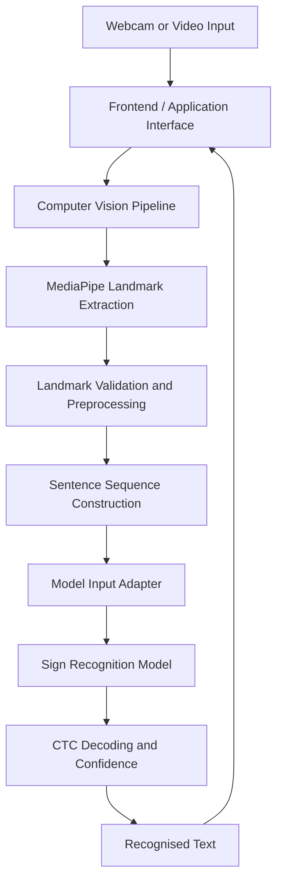

# SignBridge — Continuous Sign Language Recognition

> An AI-powered sign-language recognition prototype that converts sequences of American Sign Language (ASL) signs into readable text using computer vision and deep learning.

**TECHNOVA 2026 · Problem Statement PS-41 · Continuous Sign Language Recognition at Sentence Level**

[Repository](https://github.com/Adithya-devcoder/TechNova_Hackathon) · [Issues](https://github.com/Adithya-devcoder/TechNova_Hackathon/issues)

---

## Table of Contents

- [Overview](#overview)
- [Problem Statement](#problem-statement)
- [Features](#features)
- [Technology Stack](#technology-stack)
- [System Architecture](#system-architecture)
- [Repository Structure](#repository-structure)
- [Prerequisites](#prerequisites)
- [Getting Started](#getting-started)
- [Running the Application](#running-the-application)
- [Computer Vision Pipeline](#computer-vision-pipeline)
- [Machine Learning Model](#machine-learning-model)
- [Dependencies and Environments](#dependencies-and-environments)
- [Testing](#testing)
- [Evaluation and Results](#evaluation-and-results)
- [Dataset and Model Assets](#dataset-and-model-assets)
- [Troubleshooting](#troubleshooting)
- [Limitations](#limitations)
- [Privacy and Responsible Use](#privacy-and-responsible-use)
- [Future Improvements](#future-improvements)
- [Team Contributions](#team-contributions)
- [Acknowledgements and Licences](#acknowledgements-and-licences)

---

## Overview

SignBridge is a prototype developed for TECHNOVA 2026 to explore continuous sign-language recognition at sentence level.

Instead of treating each sign as an independent prediction, the system processes a sequence of hand and upper-body movements and attempts to recognise the complete signed sequence.

The repository brings together the team's frontend, backend, computer-vision preprocessing pipeline, and machine-learning integration work on the `main` branch.

### Project goals

- Recognise sequences of signs rather than only isolated gestures.
- Extract hand and body landmarks from video.
- Process landmark sequences for sentence-level prediction.
- Present recognised text through an application interface.
- Evaluate model performance on signers excluded from training.
- Provide a codebase that team members can clone and develop collaboratively.

**Language scope:** The documented recognition model uses a limited vocabulary of 52 American Sign Language (ASL) signs. This is a research prototype, not a general-purpose sign-language translator.

## Problem Statement

**PS-41: Continuous Sign Language Recognition at Sentence Level**

Recognising continuous signing is challenging because signs flow into one another, signing speed varies, and different people perform the same sign differently.

A useful system must process temporal information, handle variations between signers, and communicate uncertainty instead of presenting every prediction as correct.

SignBridge explores this problem through landmark extraction, signer normalisation, sequence modelling, and CTC-based decoding.

## Features

| Feature | Description |
|---|---|
| Continuous sign recognition | Processes a sequence of signs as one input |
| Landmark extraction | Uses MediaPipe-based hand and body landmark processing |
| Signer normalisation | Normalises relevant landmark coordinates to reduce variation between signers |
| Sequence modelling | Uses a bidirectional GRU and Connectionist Temporal Classification (CTC) |
| Word confidence | Provides confidence estimates for recognised words |
| Uncertainty indicators | Flags predictions with lower confidence |
| Sentence construction | Supports combining recognised signs into a readable output |
| Video processing | Includes a pipeline for processing video sequences |
| Evaluation tools | Includes tests and model-evaluation utilities |
| Web application | Includes application-interface code in the repository |

Feature availability can depend on the selected recognition mode and the required model assets. Live webcam accuracy must be evaluated separately from results obtained on constructed test sequences.

## Technology Stack

| Component | Technology |
|---|---|
| Programming language | Python |
| Computer vision | MediaPipe, OpenCV |
| Machine learning | PyTorch |
| Sequence recognition | BiGRU + CTC |
| Application interface | Streamlit and the repository's frontend |
| Data processing | NumPy, pandas |
| Testing | pytest |
| Version control | Git and GitHub |

The frontend and backend have their own source files and dependencies. Refer to their package and dependency manifests for the exact versions and commands used by the current implementation.

## System Architecture



The computer-vision pipeline prepares a sequence of landmarks in the format expected by the model. The model predicts the sign sequence, and the application presents the resulting text.

The exact runtime connection between the frontend, backend, and model depends on the corresponding integration code and configuration in the repository.

## Repository Structure

The consolidated repository includes the application code, computer-vision pipeline, model-related code, tests, and configuration files.

Important files and directories include:

```text
TechNova_Hackathon/
├── frontend/                     # Frontend application
├── signbridge/
│   ├── interface/
│   │   ├── adapter.py             # Model input/output integration
│   │   └── contract.py            # Interface contract
│   ├── preprocessing/
│   │   ├── capture.py              # Capture utilities
│   │   ├── landmark_extractor.py   # Landmark extraction
│   │   ├── pipeline.py             # CV processing pipeline
│   │   ├── sentence_buffer.py      # Sentence buffering
│   │   └── sequence_builder.py     # Sequence preparation
│   └── tests/                      # CV pipeline tests
├── models/                         # Model code and available assets
├── app/                            # Application code, where present
├── tests/                          # Application/model tests, where present
├── demo_e2e.py                     # End-to-end dry-run demo
├── test_landmarks.py               # Landmark-related tests
├── test_webcam.py                  # Webcam-related tests
├── requirements.txt                # Main application dependencies
├── requirements-cv.txt             # CV-specific dependencies
├── pytest.ini                      # pytest configuration
└── README.md
```

This is a guide to the main components, not an exhaustive file listing. Some optional model weights, datasets, or assets may not be committed to GitHub.

## Prerequisites

Install the following before setting up the project:

- Git
- Python versions compatible with the relevant dependency set
- Node.js and npm if running the frontend
- A working webcam for live recognition
- A Windows, macOS, or Linux development environment
- Internet access for installing dependencies and obtaining optional assets

The main dependency set was documented as tested with Python 3.13 on Windows. The computer-vision dependency set was documented as tested with Python 3.11 on Windows. Use separate environments where required; see [Dependencies and Environments](#dependencies-and-environments).

## Getting Started

### 1. Clone the repository

Open a terminal and run:

```bash
git clone https://github.com/Adithya-devcoder/TechNova_Hackathon.git
cd TechNova_Hackathon
git checkout main
```

The `main` branch contains the merged backend, frontend, and computer-vision contributions.

### 2. Create the main Python environment

On Windows PowerShell:

```powershell
python -m venv .venv
```

Install the main dependencies:

```powershell
.\.venv\Scripts\python.exe -m pip install --upgrade pip
.\.venv\Scripts\python.exe -m pip install -r requirements.txt
```

On macOS or Linux:

```bash
python3 -m venv .venv
source .venv/bin/activate
python -m pip install --upgrade pip
python -m pip install -r requirements.txt
```

### 3. Install frontend dependencies

If the frontend contains a `package.json`, install its declared dependencies:

```bash
cd frontend
npm install
```

Return to the repository root when needed:

```bash
cd ..
```

Use the scripts declared in `frontend/package.json` to determine the correct development and production commands:

```bash
npm run
```

For example, use `npm run dev` only if the frontend defines a `dev` script.

### 4. Configure environment variables

Check the application configuration and `.env.example` files, if present.

Create local environment files for required settings, such as API URLs or service configuration. Use the variable names expected by the code.

**Never commit API keys, credentials, private model files, or real `.env` files.** The repository's `.gitignore` excludes environment files.

## Running the Application

The exact startup commands should match the scripts and entry points present in the checked-out `main` branch.

### Frontend

```bash
cd frontend
npm run
```

Review the listed scripts and start the application using the script defined by the project.

### Python application

If `app/main.py` is present and is the intended Streamlit entry point, run it from the repository root using the main environment.

Windows:

```powershell
.\.venv\Scripts\python.exe -m streamlit run app/main.py
```

macOS or Linux:

```bash
.venv/bin/python -m streamlit run app/main.py
```

When Streamlit starts successfully, open the local URL printed in the terminal, commonly `http://localhost:8501`.

If your setup uses a separate backend server, start it using its own documented entry point and dependencies. Do not assume the Streamlit command also starts a separate API server.

## Computer Vision Pipeline

The computer-vision pipeline converts video frames into structured landmark sequences suitable for recognition.

### Processing steps

1. Capture frames from a webcam or video.
2. Extract hand and upper-body landmarks.
3. Validate landmark data and represent missing landmarks appropriately.
4. Build a sentence-level sequence.
5. Adapt the sequence to the model's input contract.
6. Pass the prepared sequence to the recognition model.
7. Return the recognised text and available confidence information.

### Landmark input format

The model contract expects a NumPy array with shape:

```text
(T, 543, 3)
```

Where:

- `T` is the number of frames in the complete sentence.
- Each frame contains 543 landmark slots.
- Each landmark contains normalised `(x, y, z)` coordinates.

The documented landmark order is:

| Landmark group | Indices |
|---|---|
| Face | 0–467 |
| Left hand | 468–488 |
| Pose | 489–521 |
| Right hand | 522–542 |

Missing landmarks should be represented as `NaN` where required by the model contract, rather than being silently replaced with zero coordinates.

The model expects a complete sentence sequence rather than a fixed 30-frame window.

### Computer-vision dependency environment

The CV requirements are provided separately because they use a different NumPy and MediaPipe version combination:

```powershell
python -m venv .venv-cv
.\.venv-cv\Scripts\python.exe -m pip install --upgrade pip
.\.venv-cv\Scripts\python.exe -m pip install -r requirements-cv.txt
```

Use the interpreter associated with this environment when testing the CV pipeline. Do not install the CV requirements into the main environment without resolving and testing dependency compatibility.

## Machine Learning Model

The documented SignBridge recognition model uses a bidirectional GRU (BiGRU) with CTC decoding.

### Model workflow

1. Extract hand and upper-body features from the landmark sequence.
2. Normalise coordinates relative to the signer.
3. Add temporal information, including frame-to-frame movement.
4. Predict frame-level sign probabilities.
5. Decode the predictions into a sequence of signs.
6. Calculate available word-confidence estimates and flag uncertain predictions.

The documented model contains approximately 2.38 million parameters.

### Calling the model

The expected model interface is conceptually:

```python
from models import signbridge_model as sb

bundle = sb.load_model()
result = sb.predict(landmarks)
```

Here, `landmarks` must follow the model's documented input contract. The model code and its required weights must be available for this example to run.

### Model files

Model weights are not guaranteed to be present in a fresh clone. Check the repository's `models/` directory and follow the model-asset instructions below before running inference.

## Dependencies and Environments

The repository provides two requirements files.

### Main application environment

`requirements.txt` contains the main application dependencies, including:

- NumPy 2.2.6
- pandas 2.3.2
- PyTorch 2.7.1
- MediaPipe 1.1.0
- Streamlit 1.65.0
- pytest 9.1.1
- ai-edge-litert 2.3.0

### Computer-vision environment

`requirements-cv.txt` contains:

- NumPy 1.26.4
- OpenCV 4.11.0.86
- MediaPipe 0.10.21
- pytest 9.1.1

These requirements sets intentionally specify different versions. In particular, NumPy and MediaPipe compatibility must be respected.

**Important:** Installing both files into one environment can cause dependency conflicts. Keep separate virtual environments unless the dependencies have been deliberately reconciled and the complete test suite passes.

The main model integration may use a separate Python interpreter or subprocess. If so, configure the interpreter path according to the integration code and the local machine; do not rely on an absolute path from another developer's computer.

## Testing

Run tests from the repository root.

### Computer-vision tests

On Windows, if the CV environment has been installed:

```powershell
.\.venv-cv\Scripts\python.exe -m pytest -q signbridge/tests
```

On macOS or Linux, use the equivalent interpreter path:

```bash
.venv-cv/bin/python -m pytest -q signbridge/tests
```

### Main environment tests

```powershell
.\.venv\Scripts\python.exe -m pytest
```

The configured pytest paths may include tests from more than one component. Run tests using the environment that contains the dependencies required by those tests.

### End-to-end dry run

The repository includes `demo_e2e.py`. Inspect its configuration and required model assets before running it:

```powershell
.\.venv\Scripts\python.exe demo_e2e.py
```

A successful synthetic dry run verifies only the path covered by that test. It does not establish real-world webcam accuracy or prove that every frontend and backend feature works.

## Evaluation and Results

The original model evaluation reported the following results on 1,000 constructed continuous test sentences from three signers excluded from training.

| Method | Standard WER | Random-order WER |
|---|---:|---:|
| Sliding-window Logistic Regression baseline | 175.8% | 166.2% |
| Baseline with smoothing | 96.2% | 96.6% |
| Model without signer normalisation | 24.6% | 35.0% |
| **SignBridge BiGRU + CTC** | **21.0%** | **29.4%** |

Additional reported results:

- 510 of 1,000 test sentences were recognised exactly.
- For sentences with mean word confidence of at least 0.9, the reported WER was 6.7%.
- Recognition latency was reported at approximately 8 ms for a 1-second sentence and 77 ms for a 10-second sentence on the tested laptop CPU.

### How to interpret these results

The test sentences were constructed by joining isolated dataset clips and interpolating transitions. They were not recorded as naturally continuous sentences.

Therefore:

- These metrics describe the documented constructed test set.
- They do not establish equivalent accuracy for live webcam signing.
- The confidence threshold results are conditional results, not overall accuracy.
- The hybrid pretrained recogniser has not been scored on the same held-out test split.
- Live evaluation with additional signers is still necessary.

Use the evaluation scripts and reports included in the repository to reproduce results where the necessary datasets, model weights, and environment are available.

## Dataset and Model Assets

### Dataset

The original model uses the Google ASL Signs dataset from Kaggle:

https://www.kaggle.com/competitions/asl-signs

The documented experiment selected 52 signs from the dataset's larger vocabulary. The full dataset is not included in this GitHub repository.

To reproduce training, accept the dataset competition rules and follow the training notebook and instructions in the repository.

### Optional pretrained hybrid recogniser

The project documentation describes an optional hybrid mode using a pretrained ASL recogniser.

Its required assets include:

- `model.tflite`
- `sign_to_prediction_index_map.json`

These files must be obtained from their original sources and placed in the expected model directory before enabling that mode. Review the source terms and model licence before redistributing or using the files.

Do not assume optional model assets are available just because their integration code is present.

## Troubleshooting

### `ModuleNotFoundError`

Activate or invoke the correct virtual environment and install the requirements for the component you are running.

### NumPy or MediaPipe dependency errors

The main and CV dependency files use different versions. Recreate the appropriate environment instead of mixing the requirements files.

### Model weights are missing

Check the `models/` directory and the model-asset instructions. A fresh Git clone does not automatically include files that were excluded from version control.

### Webcam is unavailable

Close other applications using the camera, check operating-system camera permissions, and verify that the correct camera is selected.

### Frontend cannot connect to the backend

Confirm that both services are running, the configured API URL is correct, and the backend allows requests from the frontend's local origin.

### Application works on one machine but not another

Verify Python and Node.js versions, environment variables, model assets, dependency versions, and the configured model interpreter path. Avoid machine-specific absolute paths in committed configuration.

### Tests fail after cloning

Install the dependencies for the specific tests, run them in the intended environment, and check whether optional assets or datasets are required.

## Limitations

- **Limited vocabulary:** The documented model recognises only the selected 52 ASL signs.
- **ASL only:** The model is not an Indian Sign Language (ISL) recogniser.
- **Constructed sentences:** The reported test data approximates continuous signing using joined isolated clips.
- **Live accuracy not established:** Webcam performance requires a separate evaluation with real signers.
- **Facial expressions:** The documented model focuses on hands and selected upper-body landmarks; facial grammar is not fully modelled.
- **Approximate English conversion:** Recognised sign labels may be converted to readable English using rules, which do not cover every sentence structure.
- **Confidence is not certainty:** A high confidence score does not guarantee a correct translation.
- **Environment differences:** Computer-vision and model dependencies may require separate Python environments.
- **Optional model assets:** Some pretrained files and datasets must be downloaded separately.

## Privacy and Responsible Use

The original application design describes local webcam processing and does not intend to store webcam frames. Verify the actual integrated code and configuration before making privacy guarantees about the complete application.

- Obtain consent before recording or evaluating signers.
- Do not commit personal recordings, credentials, or private datasets.
- Clearly communicate uncertainty in recognition results.
- Do not use this prototype as a replacement for qualified sign-language interpreters in medical, legal, emergency, or other high-stakes situations.
- Conduct usability and accuracy testing with Deaf and hard-of-hearing people before considering real-world deployment.

## Future Improvements

- Expand vocabulary and support out-of-vocabulary rejection.
- Evaluate on naturally continuous signing from additional signers.
- Improve temporal modelling and landmark robustness.
- Add broader support for facial and non-manual sign features.
- Investigate Indian Sign Language using an appropriate ISL dataset.
- Improve multilingual output and text-to-speech.
- Simplify cross-platform installation and dependency management.
- Add automated integration testing for frontend, backend, and model inference.
- Document and automate deployment.

## Team Contributions

This project was developed collaboratively for TECHNOVA 2026.

| Team role | Responsibility |
|---|---|
| Member 1 | AI/ML model and training |
| Member 2 | Computer vision and data pipeline |
| Member 3 | Frontend and integration |
| Member 4 | Evaluation and submission |

Update this section with the team's final names and links before submission.

## Acknowledgements and Licences

- **Dataset:** [Google ASL Signs on Kaggle](https://www.kaggle.com/competitions/asl-signs), subject to the dataset's terms.
- **Computer vision:** [MediaPipe](https://github.com/google-ai-edge/mediapipe).
- **Machine learning:** PyTorch, NumPy, pandas, and related open-source libraries.
- **Optional pretrained recogniser:** [Hoyeol Sohn's ASL Signs solution](https://github.com/hoyso48/Google---Isolated-Sign-Language-Recognition-1st-place-solution), subject to its applicable licence and the licences of its assets.

This project is a hackathon prototype. Choose and add a project licence only after confirming the team's rights to distribute the code and that doing so is compatible with third-party licences. Third-party datasets and model weights retain their own terms.

## Contributing

Team members can contribute by working on their assigned components, creating feature branches, testing changes, and submitting pull requests for review.

Before merging changes:

1. Confirm that generated files, private assets, and secrets are not staged.
2. Run relevant tests.
3. Update setup instructions when dependencies or entry points change.
4. Verify that the application works with the intended environment.
5. Document any new external assets or configuration requirements.

---

**Repository:** [Adithya-devcoder/TechNova_Hackathon](https://github.com/Adithya-devcoder/TechNova_Hackathon)

**Project:** SignBridge — Continuous Sign Language Recognition at Sentence Level

**Event:** TECHNOVA 2026 · PS-41
