# SignBridge — Reliable Continuous Sign-to-Text

> Breaking communication barriers through reliable sign-language recognition.

SignBridge is a hackathon prototype for **continuous, sentence-level sign language recognition**, built for **TECHNOVA 2026**. It aims to convert sequences of signs, captured through a laptop webcam, into readable text, with confidence-aware output and an optional translation layer for English, Tamil, Hindi, and Telugu.

**Category:** AI/ML · Computer Vision · Accessibility · Natural Language Processing

> **Project status:** Early-stage prototype. Features below are labelled **Implemented**, **Planned**, or **Future**. Nothing marked *Planned* or *Future* should be assumed to work yet. Update the status column as the codebase evolves.

---

## Table of Contents

1. [Problem Statement](#problem-statement)
2. [Why SignBridge Matters](#why-signbridge-matters)
3. [Project Objectives](#project-objectives)
4. [Key Features](#key-features)
5. [How the System Works](#how-the-system-works)
6. [System Architecture](#system-architecture)
7. [Technology Stack](#technology-stack)
8. [Dataset and Data Preparation](#dataset-and-data-preparation)
9. [Model Architecture and Design Choices](#model-architecture-and-design-choices)
10. [Installation and Setup](#installation-and-setup)
11. [Configuration](#configuration)
12. [How to Run the Application](#how-to-run-the-application)
13. [Example Usage](#example-usage)
14. [Multilingual Support](#multilingual-support)
15. [Evaluation Methodology](#evaluation-methodology)
16. [Results and Performance Metrics](#results-and-performance-metrics)
17. [Limitations](#limitations)
18. [Privacy and Responsible Use](#privacy-and-responsible-use)
19. [Future Enhancements](#future-enhancements)
20. [Project Structure](#project-structure)
21. [Contributing](#contributing)
22. [License](#license)
23. [Acknowledgements](#acknowledgements)
24. [Team and Contact](#team-and-contact)

---

## Problem Statement

**Continuous Sign Language Recognition at Sentence Level.**

Recognizing individual signs or fingerspelled letters is a comparatively well-studied task. Understanding *continuous* signing, where signs flow into one another, and converting whole signed sentences into text is much harder. A usable system must:

- process **sequences** of signs rather than isolated clips,
- cope with **variation between signers** (speed, style, body proportions, camera position),
- and produce **readable text** as output.

## Why SignBridge Matters

Many Deaf and hard-of-hearing people use sign language as their primary language, while most hearing people do not understand it. This gap affects everyday situations such as healthcare, education, public services, and workplaces. A reliable sign-to-text tool could help reduce that gap, but only if it is honest about its errors and generalizes beyond the few people it was trained on. SignBridge is built around that idea.

## Project Objectives

- Recognize a vocabulary of **at least 50 signs** in continuous sequences.
- Run **real-time inference on a laptop** using a webcam.
- Measure **Word Error Rate (WER)** on **held-out signers** not seen during training.
- Demonstrate at least **10 complete sentences** live.
- Surface **uncertainty** in predictions instead of hiding it.

## Key Features

| # | Feature | Status |
|---|---------|--------|
| 1 | Continuous sign-language recognition (sequences, not just isolated signs) | Planned |
| 2 | Indian Sign Language (ISL) as the initial target language | Planned |
| 3 | Pose and hand landmark extraction | Planned |
| 4 | Temporal sequence modelling (LSTM, Transformer, or CTC-based; to be compared) | Planned |
| 5 | Real-time webcam inference on a laptop | Planned |
| 6 | Confidence-aware predictions (flagging uncertain words/sentences) | Planned |
| 7 | Correction mechanism for recognition errors (where feasible) | Planned |
| 8 | Multilingual text output: English, Tamil, Hindi, Telugu via a translation layer | Planned |
| 9 | Optional text-to-speech of the output | Planned |
| 10 | Text-to-sign generation or avatar-based interface | Future |

> Replace "Planned" with "Implemented" only once the feature works in the repository and has been tested.

### What makes SignBridge different

SignBridge's intended differentiator is **reliable continuous recognition with confidence-aware output**. Beyond basic isolated-sign classification, it aims to:

- process sequences of signs,
- evaluate generalization to **unseen signers**,
- report **word-level** recognition errors,
- identify uncertain predictions and allow corrections where feasible,
- support several spoken-language outputs through a **separate translation layer**.

These are design goals. They are not claims of being the first or best solution.

## How the System Works

1. **Capture:** Frames are read from the webcam.
2. **Frame processing:** Frames are resized and normalized.
3. **Landmark extraction:** Hand, pose, and (optionally) face landmarks are extracted per frame, reducing raw video to compact numerical features.
4. **Sequence modelling:** A temporal model reads the landmark sequence and predicts the signed words.
5. **Confidence assessment:** Each predicted word receives a confidence score; low-confidence words are flagged.
6. **Sentence output:** Predicted words are assembled into text shown in the interface.
7. **Optional steps:** Translation into other languages and text-to-speech.

## System Architecture

> Proposed pipeline. Dashed boxes are optional components and are not assumed to be working.

```mermaid
flowchart LR
    A[Webcam input] --> B[Frame processing]
    B --> C[Hand and body landmark extraction]
    C --> D[Temporal sequence model]
    D --> E[Sign-to-text prediction]
    E --> F[Confidence assessment]
    F --> G[Sentence output]
    G -.-> H[Optional: translation layer]
    H -.-> I[Optional: text-to-speech]
    F -.-> J[Optional: user correction]
    J -.-> G

    style H stroke-dasharray: 5 5
    style I stroke-dasharray: 5 5
    style J stroke-dasharray: 5 5
```



## Technology Stack

> **Proposed stack.** Verify against `requirements.txt` and the actual code before publishing.

| Area | Tool |
|------|------|
| Language | Python |
| Video capture and image processing | OpenCV |
| Landmark extraction | MediaPipe Holistic (or another suitable hand/body landmark extractor) |
| Deep learning | PyTorch |
| Data handling | NumPy, Pandas |
| Baselines and evaluation utilities | scikit-learn |
| Word Error Rate | jiwer |
| User interface | Streamlit |
| Version control | Git and GitHub |

FastAPI will be added only if a separate backend API turns out to be necessary.

## Dataset and Data Preparation

> No dataset has been confirmed as downloaded or processed in this repository. Update this section with real details once data work is done.

### Candidate datasets

| Dataset | Language | Notes |
|---------|----------|-------|
| [ISLTranslate](https://github.com/Exploration-Lab/ISLTranslate) | Indian Sign Language | Most relevant starting candidate for an ISL project. Current structure, availability, annotations, and license must be verified. |
| [How2Sign](https://how2sign.github.io/) | American Sign Language | Large-scale ASL dataset. Cannot simply replace an ISL dataset. |
| [WLASL](https://github.com/dxli94/WLASL) | American Sign Language | Word-level ASL dataset. Cannot simply replace an ISL dataset. |

ASL and ISL are different languages with different vocabularies and grammar. How2Sign and WLASL may still be useful for experimenting with the pipeline or for pretraining ideas, but they do not provide ISL recognition by themselves.

### Planned data preparation steps

1. Verify dataset availability, structure, and license.
2. Select a vocabulary of at least 50 signs and the sentences that use them.
3. Extract landmarks from videos and save them as feature files.
4. Split data **by signer**, so evaluation signers never appear in training.
5. Document the final vocabulary, number of signers, and number of samples.

### Licensing and consent

Check each dataset's **license, usage restrictions, consent terms, and attribution requirements** before using it, especially before any commercial deployment. Do not redistribute datasets or commit them to this repository.

## Model Architecture and Design Choices

> To be finalized. Document what is actually built.

Candidate approaches under consideration:

- **Baseline:** a simple classifier (for example, scikit-learn) on landmark features, used for comparison.
- **LSTM / GRU:** recurrent models over landmark sequences.
- **Transformer encoder:** attention over the landmark sequence.
- **CTC loss:** lets the model learn alignment between a frame sequence and a word sequence without frame-level labels, which suits continuous signing.

Design choices to record here once decided: input features, sequence length, model size, loss function, training setup, and how confidence scores are computed (for example, softmax probability or other calibration methods).

## Installation and Setup

> These commands are templates. The final commands **must match the actual repository structure**. Replace placeholders accordingly.

**Prerequisites:** Python 3.x (`[Python version]`), `git`, and a working webcam.

```bash
# 1. Clone the repository
git clone [GitHub Repository URL]
cd [repository-folder]

# 2. Create a virtual environment
python -m venv venv

# 3. Activate it
# Windows (PowerShell):
venv\Scripts\Activate.ps1
# macOS / Linux:
source venv/bin/activate

# 4. Install dependencies
pip install -r requirements.txt
```

## Configuration

Describe any configuration here once it exists, for example:

| Setting | Description | Default |
|---------|-------------|---------|
| `[camera index]` | Which webcam to use | `[TBD]` |
| `[model path]` | Location of trained model weights | `[TBD]` |
| `[confidence threshold]` | Below this, a word is flagged as uncertain | `[TBD]` |
| `[target language]` | Output language for the translation layer | `[TBD]` |

Large model weights should be stored outside the repository (for example, in releases or external storage) and linked from here.

## How to Run the Application

> Replace with the real entry point once confirmed.

```bash
# Example only, if the Streamlit app lives at app/main.py
streamlit run [path/to/app_entry_point.py]
```

Then open the local URL shown in the terminal (typically `http://localhost:8501`) and allow webcam access.

## Example Usage

Fill this in with real behaviour after testing. A suggested format:

| Signed sentence (ISL) | Recognized text | Confidence flags | Notes |
|-----------------------|-----------------|------------------|-------|
| `[sentence 1]` | `[output]` | `[TBD]` | `[TBD]` |
| `[sentence 2]` | `[output]` | `[TBD]` | `[TBD]` |

Add screenshots or a short demo GIF here: ``. Only include media that you have permission to share.

## Multilingual Support

SignBridge aims to show recognized meaning in **English, Tamil, Hindi, and Telugu**.

- ISL is a **distinct language**, not a word-for-word encoding of any spoken language.
- Output in other languages therefore needs an **appropriate translation step**, not simple word substitution.
- The translation layer is **separate** from sign recognition, so recognition accuracy and translation quality should be evaluated independently.
- Translation tooling (`[translation method / library]`) is **to be decided**.

## Evaluation Methodology

### Word Error Rate (WER)

```
WER = (Substitutions + Deletions + Insertions) / Number of reference words
```

Lower is better. WER can exceed 100% if there are many insertions. It is computed by aligning the predicted word sequence against the reference sentence, for example with [`jiwer`](https://github.com/jitsi/jiwer).

### Why unseen signers matter

If the same signers appear in both training and test data, a model can learn individual habits (hand shape, speed, camera framing) instead of the signs themselves, and results look better than they truly are. Testing on **signers excluded from training** measures whether the model generalizes to new people, which is what real users will be.

### Planned evaluation setup

- Split train/validation/test **by signer**.
- Report WER on the held-out-signer test set.
- Measure inference latency on the target laptop (state hardware).
- Run a live demonstration of at least 10 complete sentences and record the results honestly, including failures.

## Results and Performance Metrics

> No measurements have been recorded yet. **Do not fill in numbers that were not actually measured.**

| Metric | Baseline | SignBridge | Evaluation method |
|--------|----------|------------|-------------------|
| Word Error Rate (WER) | TBD | TBD | Held-out signer test set |
| Inference latency | TBD | TBD | Measure on target laptop |
| Vocabulary size | TBD | TBD | Count validated signs |
| Complete sentences tested | TBD | TBD | Document test examples |
| Unseen-signer performance | TBD | TBD | Test on signers excluded from training |

## Limitations

- The prototype is limited to a small vocabulary and a limited set of sentence patterns.
- Performance may drop with different lighting, backgrounds, camera angles, signing speeds, or signers not represented in training data.
- Continuous sign recognition is an open research problem, so errors are expected.
- Facial expressions and body movement carry grammatical meaning in sign languages, and the current feature set may capture them only partially.
- Translation into other languages may lose nuance.
- Dataset constraints (size, signer diversity, licensing) limit what the model can learn.

## Privacy and Responsible Use

- Process webcam frames **locally** where practical.
- **Do not store webcam footage by default.**
- Obtain **informed consent** before collecting or using recordings of signers.
- Do not upload personal recordings to public repositories.
- This prototype can make mistakes. It **must not replace qualified human interpreters** in critical situations such as medical, legal, or emergency settings.
- Involve Deaf and hard-of-hearing community members in testing and feedback wherever possible.

## Future Enhancements

- Larger vocabulary and more signers for better generalization.
- Stronger confidence calibration and an in-app correction loop that feeds back into training.
- Better handling of facial expressions and non-manual markers.
- Text-to-sign generation or an avatar-based interface, subject to data and time.
- Lightweight or on-device deployment (for example, mobile).

## Project Structure

> Example structure. Update to match the real repository.

```
signbridge/
├── app/              # User interface and application entry point (e.g. Streamlit)
├── data/             # Local data placeholders and instructions (do not commit large datasets)
├── models/           # Model definitions; trained weights stored externally if large
├── preprocessing/    # Frame handling, landmark extraction, dataset preparation
├── training/         # Training scripts and configuration
├── evaluation/       # WER computation, latency measurement, signer-held-out evaluation
├── tests/            # Unit and integration tests
├── notebooks/        # Exploration and experiments
├── requirements.txt  # Python dependencies
├── .gitignore        # Excludes data, weights, caches, and generated files
├── README.md
└── LICENSE
```

Avoid committing large datasets, model weights, private recordings, or generated files. Use `.gitignore` and external storage instead.

## Contributing

Contributions and feedback are welcome.

1. Fork the repository.
2. Create a feature branch: `git checkout -b feature/your-feature`.
3. Make your changes with clear commit messages.
4. Test your changes and update documentation if needed.
5. Open a pull request describing what you changed and why.

Please do not submit personal recordings or datasets without confirming consent and licensing.

## License

`[License]` — choose a license (for example MIT or Apache-2.0) and add a matching `LICENSE` file. Third-party datasets and models keep their own licenses.

## Acknowledgements

- TECHNOVA 2026 organizers for the problem statement.
- Dataset creators: [ISLTranslate](https://github.com/Exploration-Lab/ISLTranslate), [How2Sign](https://how2sign.github.io/), [WLASL](https://github.com/dxli94/WLASL), subject to each dataset's license and citation requirements.
- Open-source libraries used in this project (OpenCV, MediaPipe, PyTorch, scikit-learn, jiwer, Streamlit, and others as applicable).
- `[Mentors / community members / other acknowledgements]`

## Team and Contact

| Field | Details |
|-------|---------|
| Team name | `[Team Name]` |
| Members | `[Name — role]` |
| Institution | `[Institution]` |
| Contact | `[Email / LinkedIn]` |
| Repository | `[GitHub Repository URL]` |
