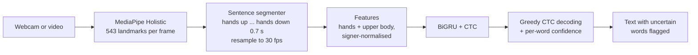

# SignBridge: Continuous Sign-to-Text

> Turns sequences of signs from a laptop webcam into text, and shows how sure it is about every word.

SignBridge is our **TECHNOVA 2026** prototype for **PS-41: Continuous Sign Language Recognition at Sentence Level**. It recognises sentences made from a **52-sign American Sign Language (ASL) vocabulary**, runs in real time on a laptop CPU, and is evaluated on **signers it never saw during training**.

**Category:** AI/ML · Computer Vision · Accessibility

## Results at a glance

Measured on **1,000 continuous test sentences signed by 3 people who never appear in training** (details in [Evaluation](#evaluation)).

| Method | Word error rate (WER) ↓ | WER, random sign orders ↓ |
|---|---|---|
| Baseline: sliding window + LogisticRegression | 175.8% | 166.2% |
| Baseline + smoothing (tuned on validation signers) | 96.2% | 96.6% |
| Ablation: our model without signer normalisation | 24.6% | 35.0% |
| **SignBridge: BiGRU + CTC** | **21.0%** | **29.4%** |

- 510 of 1,000 sentences are recognised exactly right.
- When the model is confident (mean word confidence ≥ 0.9), WER drops to **6.7%**; below 0.6 it is **74.6%**, so the uncertainty flags are meaningful.
- Recognition takes **8 ms for 1 s of signing and 77 ms for 10 s** on a laptop CPU.

These test sentences are built from isolated dataset clips (see [How it works](#how-it-works)). **Live webcam accuracy has not been measured yet**; the app includes a mode for exactly that.

## Contents
1. [Problem](#problem)
2. [What the prototype does](#what-the-prototype-does)
3. [How it works](#how-it-works)
4. [Quick start](#quick-start)
5. [Reproduce training](#reproduce-training)
6. [Evaluation](#evaluation)
7. [Optional: pretrained hybrid recogniser](#optional-pretrained-hybrid-recogniser)
8. [Model input and output](#model-input-and-output)
9. [Project structure](#project-structure)
10. [Limitations](#limitations)
11. [Privacy and responsible use](#privacy-and-responsible-use)
12. [Future work](#future-work)
13. [Acknowledgements and licences](#acknowledgements-and-licences)

## Problem

Recognising single signs or fingerspelled letters is well studied. Understanding **continuous** signing, where signs flow into one another, is much harder. A usable system has to:
- read **sequences** of signs, not single clips;
- cope with **variation between signers** (speed, style, body size, camera position);
- produce **readable text**, and be honest about its mistakes.

PS-41 asks for a vocabulary of at least 50 signs, real-time inference on a laptop, word error rate on unseen signers, and a live demo of at least 10 full sentences.

## What the prototype does

| Feature | Status |
|---|---|
| Continuous recognition of sign sequences (52 ASL signs) | Implemented, tested on held-out signers |
| Hand and body landmark extraction (MediaPipe Holistic) | Implemented |
| Real-time webcam app: sign, lower your hands, read the sentence | Implemented; live accuracy not yet measured |
| Confidence for every word; uncertain words flagged with top-3 alternatives | Implemented |
| Recognise an uploaded video (split into sentences automatically) | Implemented |
| Live evaluation mode: sign reference sentences, get live WER | Implemented |
| Hybrid with the Kaggle 1st-place pretrained model (250 signs) | Implemented; needs a separate download, not yet scored |
| Translation into Tamil, Hindi and Telugu; text-to-speech | Future |
| Rejecting gestures that are not in the vocabulary | Future (see [Limitations](#limitations)) |
| Text-to-sign avatar | Future |

## How it works



**1. Data.** [Google ASL Signs](https://www.kaggle.com/competitions/asl-signs) (Kaggle): 94,477 clips of 250 isolated signs from 21 signers, with MediaPipe Holistic landmarks already extracted. We use **52 signs that combine into sentences** (people, pronouns, actions, food, places, feelings, time): 19,590 clips.

**2. Signer-disjoint split.** 15 signers for training, 3 for validation, **3 for testing** (`data/splits/split.json`). Nothing from a test signer is ever used in training.

**3. Continuous sentences from isolated clips (the core idea).** The dataset has single signs only, so we build sentences: 2–5 clips **from the same signer and the same split** are joined, each clip is randomly sped up or slowed down (0.8–1.25×), and 3–8 interpolated frames are inserted between signs to imitate the movement from one sign to the next. Half the sentences follow 16 meaningful templates (for example `mom drink water now`); half are random sign orders, so the model cannot simply memorise sentences. Training draws 20,000 new sentences per epoch.

**4. Features.** Per frame we keep both hands (2 × 21 points) and 7 upper-body points (nose, shoulders, elbows, wrists). Each sentence is **signer-normalised**: mirrored so the dominant hand is always on the same side, centred on the shoulder midpoint and scaled by shoulder width. We add frame-to-frame velocity and a presence flag per hand: 198 numbers per frame. Missing hands are handled explicitly rather than treated as real coordinates.

**5. Model.** Linear projection → residual 1D convolution → 2-layer bidirectional GRU (256 units) → per-frame sign probabilities, trained with **CTC loss**, which learns where each sign is without frame-level labels. 2.38M parameters.

**6. Decoding and confidence.** Greedy CTC decoding. A word's confidence is its average probability over the frames that produced it; words below 0.6 (adjustable) are flagged as uncertain, with the top-3 alternatives.

**7. Live use.** The app collects frames while hands are visible and recognises the sentence once the hands have been down for 0.7 s. MediaPipe runs at about 11 fps on our laptop CPU, so each sentence is resampled to the 30 fps the model was trained on.

## Quick start

Requires Python 3.13 (tested on Windows 11, CPU only), Git and a webcam.

```powershell
git clone https://github.com/Adithya-devcoder/TechNova_Hackathon.git
cd TechNova_Hackathon
git checkout test-abe

python -m venv .venv
.venv\Scripts\python -m pip install -r requirements.txt

.venv\Scripts\python -m streamlit run app/main.py
```

On macOS or Linux use `.venv/bin/python` instead of `.venv\Scripts\python`.

The app opens at http://localhost:8501. The MediaPipe model file (`models/holistic_landmarker.task`, 13.7 MB) downloads automatically on first use.

**Using the app**
1. Choose a mode in the sidebar: **Live webcam**, **Upload video** or **Live evaluation**.
2. Switch on the camera and sign a sentence using signs from the **Vocabulary** list in the sidebar (for example `mom drink water now`).
3. Lower your hands for about a second. The sentence appears with confident words in green and uncertain words in amber with a "?". Hover over a word to see its alternatives.

**Other commands**
```powershell
.venv\Scripts\python -m pytest                          # 25 automated tests
.venv\Scripts\python -m evaluation.benchmark_latency    # latency on this machine
.venv\Scripts\python -m evaluation.error_analysis       # regenerate evaluation/error_analysis.md
.venv\Scripts\python -m evaluation.live_log             # live WER from Live evaluation mode
.venv\Scripts\python -m models.predict_clip clip.npy    # recognise one saved clip [T, 543, 3]
```

## Reproduce training

Training runs in a Kaggle notebook, where the 40 GB dataset is already available.

1. Accept the competition rules at https://www.kaggle.com/competitions/asl-signs/rules.
2. At https://www.kaggle.com/competitions/asl-signs/code, click **New Notebook**, then **File → Import Notebook** and choose [training/signbridge_kaggle.ipynb](training/signbridge_kaggle.ipynb).
3. In the notebook settings, set **Accelerator: GPU** and **Internet: On**, and check that `asl-signs` is attached as input.
4. Run the cells in order. On a Tesla T4: loading the clips takes about 2.5 min, the baseline about 2 min, and training (25 epochs, about 42 s each) about 18 min.
5. The last cell writes `signbridge_member1.zip` with `model_main.pt`, `signbridge_model.py`, `split.json`, `results.md` and `test_predictions.csv`. Unzip the files into `models/`, `data/splits/` and `evaluation/`.

Training settings: AdamW, one-cycle learning rate (max 2e-3), batch 64, mixed precision, random rotation (±12°), scaling, shifting, noise, and brief hand dropouts. The split is seeded (42), so the same signers land in the same split every time.

## Evaluation

**Metric.** Word error rate: (substitutions + deletions + insertions) ÷ reference words, computed by our own implementation and cross-checked with `jiwer` (both gave 21.0%).

**Test set.** 1,000 continuous sentences built only from the 3 test signers' clips: 460 template sentences and 540 random sign orders. Template sentences also appear in training (signed by other people), so their WER is optimistic; **the random-order WER (29.4%) is the purer recognition number.**

**Baselines.** A sliding-window LogisticRegression classifier on window statistics (175.8% WER: it outputs many extra words). A fairer version only outputs a word when 3 consecutive windows agree, with 3 chosen on the validation signers, not the test signers (96.2%).

**Ablation.** Removing signer normalisation raises WER from 21.0% to 24.6%, and from 29.4% to 35.0% on random orders. This is a single run with one random seed on 3 test signers, so the gain is consistent but not yet confirmed across seeds.

**Error analysis** ([evaluation/error_analysis.md](evaluation/error_analysis.md))
- 84% of errors are substitutions (a wrong sign); missed and extra signs are rare.
- The hardest signs are pizza (64% wrong), girl (55%) and give (51%). The most frequent confusion is pizza → brother.
- Confidence tracks correctness: 80% of sentences with mean confidence ≥ 0.9 are exactly right, against 2% below 0.6.

**Latency** (`predict()` on one whole sentence, measured with `evaluation/benchmark_latency.py` on an Intel laptop CPU, 1 thread)

| Sentence length | 1 s | 2 s | 3 s | 5 s | 10 s |
|---|---|---|---|---|---|
| Median latency | 8.4 ms | 16.1 ms | 22.7 ms | 42.0 ms | 76.7 ms |

MediaPipe landmark extraction, at about 11 fps on the same CPU, is the slower part of the live pipeline.

**Live evaluation (still to do).** In the app's **Live evaluation** mode, pick a reference sentence, sign it, and every attempt is saved to `evaluation/live_results.csv` with a running live WER. PS-41 asks for at least 10 complete sentences; `data/demo_sentences.json` lists 16.

Full results: [evaluation/results.md](evaluation/results.md). Per-sentence predictions: [evaluation/test_predictions.csv](evaluation/test_predictions.csv).

## Optional: pretrained hybrid recogniser

`models/pretrained_isolated.py` combines our model with the **1st-place model of the Kaggle ASL Signs competition** (Hoyeol Sohn, 1D-CNN + Transformer, 250 signs). Our BiGRU-CTC finds where each word is in the sentence; the pretrained model decides which sign each piece is. The app's sidebar switches between **Our model** and **Hybrid**.

To enable it:
1. Download `model.tflite` from the output of https://www.kaggle.com/code/hoyso48/1st-place-solution-inference.
2. Download `sign_to_prediction_index_map.json` from https://www.kaggle.com/competitions/asl-signs/data.
3. Put both in `models/kaggle_1st/`. The runtime (`ai-edge-litert`) is already in `requirements.txt`; the app then defaults to **Hybrid**.

**Caveat:** the pretrained model was trained on every ASL Signs signer, including our test signers, so it must not be scored on our test split. Evaluate it only with live signing by new people. Its weights are not committed because their licence is not stated.

## Model input and output

```python
from models import signbridge_model as sb

bundle = sb.load_model()          # models/model_main.pt, CPU
result = sb.predict(landmarks)    # float32 [T, 543, 3], one whole signed sentence
```

- **Input:** MediaPipe Holistic landmarks in the dataset's row order (face 0–467, left hand 468–488, pose 489–521, right hand 522–542), raw normalised x, y, z, **NaN for anything not detected**, at about 30 fps. `preprocessing/landmarks.py` produces exactly this from video frames.
- **Output:**
  ```json
  {"text": "mom drink water",
   "words": [{"word": "mom", "confidence": 0.94, "uncertain": false, "start": 12, "end": 13,
              "alternatives": [["mom", 0.94], ["dad", 0.03], ["hello", 0.01]]}],
   "latency_ms": 9.8}
  ```

## Project structure

```
app/main.py                       Streamlit app: live webcam, upload video, live evaluation
preprocessing/landmarks.py        Frames -> MediaPipe Holistic landmarks [543, 3], skeleton overlay
preprocessing/segmenter.py        Live stream -> sentences (hands up/down), resampling to 30 fps
models/signbridge_model.py        Features, BiGRU-CTC model, decoding, predict()
models/model_main.pt              Trained weights (9.5 MB)
models/pretrained_isolated.py     Optional hybrid with the Kaggle 1st-place model
models/predict_clip.py            Recognise one saved clip and check its format
training/signbridge_kaggle.ipynb  Full training and evaluation notebook (Kaggle)
evaluation/results.md             Test results, baselines, ablation, latency
evaluation/error_analysis.md      Error types, confusions, confidence analysis (made by error_analysis.py)
demo/demo_script.md               3-minute demo script with the sentence order and fallback
evaluation/live_log.py            Live demo log and live WER
evaluation/benchmark_latency.py   Latency benchmark
data/splits/split.json            Signer-disjoint train/val/test split
data/demo_sentences.json          16 demo sentences
tests/                            Automated tests (model, preprocessing, evaluation, hybrid)
```

The dataset itself is not in the repository; it stays on Kaggle.

## Limitations

- **Only 52 ASL signs.** Anything else is not recognised. The model has no "not a sign" option, so an unrelated gesture is often mapped to the closest-looking sign (in testing, a raised middle finger came out as "see"), usually with low confidence. Training with clips of other signs as negatives would fix this.
- **ASL, not Indian Sign Language.** We used the dataset with enough signers and ready landmarks for a credible held-out-signer evaluation in 24 hours. The pipeline does not depend on the language; switching to ISL means swapping the dataset.
- **Synthetic sentences.** Test sentences are joined isolated clips with interpolated transitions, not real continuous signing, so real co-articulation is only approximated.
- **Live performance is unmeasured.** The model was trained on phone videos processed with the older MediaPipe Holistic API; the app uses a laptop webcam and the newer MediaPipe Tasks API. Expect live accuracy below the test numbers.
- **Hands and upper body only.** Facial expressions, which carry grammar in sign languages, are not used.
- **Glosses, not English grammar.** Output follows sign order (`mom drink water now`), with only light clean-up for display (`minemy` → "my").
- **Overconfident words.** CTC predicts each word in a single frame, so confidences on correct words are close to 1.0.

## Privacy and responsible use

- Webcam frames are processed on the computer running the app and are **never stored**. Uploaded videos are deleted right after processing.
- Live evaluation saves only text results (reference, recognised words, confidence, latency), not video.
- This prototype makes mistakes. It **must not replace qualified interpreters**, especially in medical, legal or emergency settings.
- Testing with Deaf and hard-of-hearing signers is needed before any real use.

## Future work

- Reject out-of-vocabulary gestures by training with the dataset's other 198 signs as negatives.
- Measure live WER with new signers, then fine-tune on a small amount of real continuous signing.
- Add face landmarks and a stronger model (Transformer or Conformer); repeat the ablation over several seeds.
- Translation of recognised sentences into Tamil, Hindi and Telugu, and text-to-speech.
- Indian Sign Language with an ISL dataset; text-to-sign avatar.

## Acknowledgements and licences

- Data: [Google – Isolated Sign Language Recognition](https://www.kaggle.com/competitions/asl-signs) (Kaggle, ASL Signs), used under the competition's terms. The data is not redistributed here.
- Landmarks: [MediaPipe](https://github.com/google-ai-edge/mediapipe) Holistic Landmarker (Apache 2.0).
- Optional pretrained model: [Hoyeol Sohn's 1st-place solution](https://github.com/hoyso48/Google---Isolated-Sign-Language-Recognition-1st-place-solution) (code under MIT).
- Libraries: PyTorch, NumPy, pandas, scikit-learn, Streamlit, OpenCV, jiwer.
- Problem statement: TECHNOVA 2026 organisers, PS-41.

**Licence:** `[to be chosen, e.g. MIT]`. Third-party data and models keep their own licences.

## Team

| Name | Contact |
|---|---|
| `[Name]` | `[Email / LinkedIn]` |
| `[Name]` | `[Email / LinkedIn]` |
| `[Name]` | `[Email / LinkedIn]` |
| `[Name]` | `[Email / LinkedIn]` |

Institution: `[Institution]` · Repository: https://github.com/Adithya-devcoder/TechNova_Hackathon
